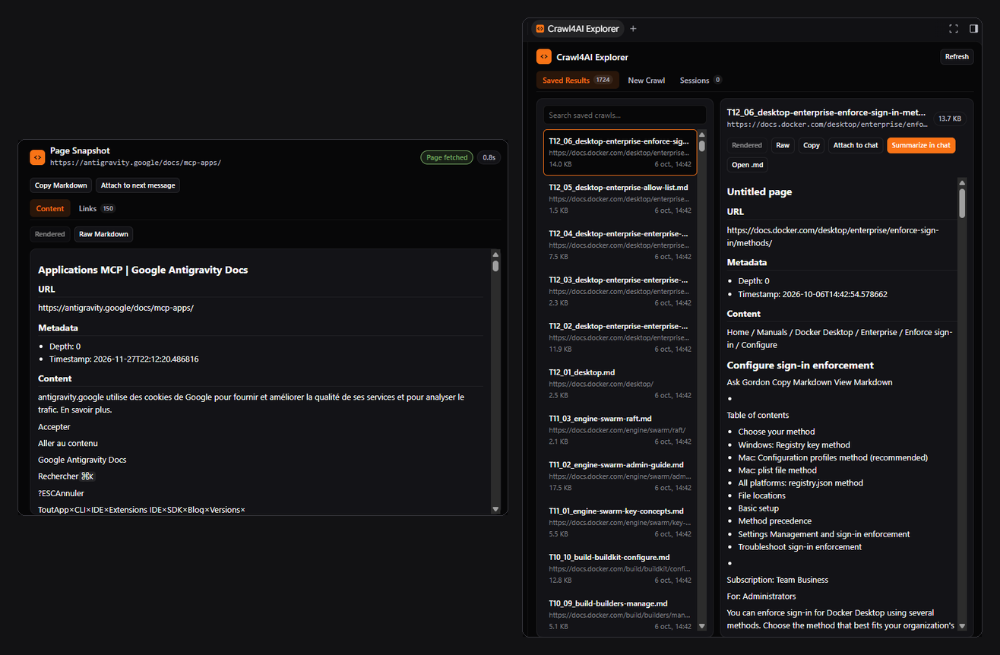

# Web Crawler MCP

<div align="center">
  
</div>

> ℹ️ [अंग्रेज़ी README](../README.md) संदर्भ संस्करण है (पर्यावरण चर, सुरक्षा, विकास)।

एक शक्तिशाली वेब क्रॉलिंग टूल जो MCP (Model Context Protocol) के माध्यम से AI सहायकों के साथ एकीकृत होता है। यह प्रोजेक्ट AI सहायकों को वेबसाइट्स को क्रॉल करने, डायनामिक कंटेंट निकालने, लिंक्स के माध्यम से नेविगेट करने और सीधे संरचित Markdown फ़ाइलों को सहेजने की अनुमति देता है।

## 📋 विशेषताएँ

- MCP के माध्यम से AI सहायकों के साथ नेटिव एकीकरण (`crawl`, `crawl_page`, `close_session`, `open_crawl_explorer`, `view_crawl_file`)
- स्क्रैप की गई Markdown कंटेंट सीधे AI को लौटाना और सहेजे गए परिणामों को MCP संसाधनों (`crawl://results/...`) के रूप में उपलब्ध कराना
- AI नेविगेशन के लिए आंतरिक/बाहरी लिंक्स निकालना और प्रदर्शित करना
- कॉन्फ़िगर करने योग्य गहराई और पृष्ठ सीमा, लाइव प्रगति सूचनाओं और विस्तृत आँकड़ों के साथ वेबसाइट क्रॉलिंग
- **इंटरैक्टिव MCP Apps (Antigravity / SEP-1865)** — wheel में पहले से बंडल (Node.js की आवश्यकता नहीं):
  - `crawl` और `crawl_page` पर **इनलाइन कार्ड** (स्थिति, आँकड़े, रेंडर्ड/रॉ Markdown पूर्वावलोकन, फ़िल्टर योग्य लिंक और छोड़े गए पृष्ठ)
  - **Crawl4AI Explorer** (`open_crawl_explorer`, साइड पैनल और फ़ुल पेज): पेजिनेटेड परिणाम ब्राउज़र, नाम/URL तथा **फ़ुल-टेक्स्ट खोज**, **प्रति-पृष्ठ TOC** (एक पृष्ठ कॉपी/संलग्न करें), क्रॉल लॉन्चर और सत्र प्रबंधन
  - **कस्टम फ़ाइल व्यूअर** (`.crawlmd` / `.crawl.md` के लिए `view_crawl_file`): प्रति-पृष्ठ TOC, मेटाडेटा और वन-क्लिक री-क्रॉल
  - नॉन-UI MCP क्लाइंट्स के लिए 100% प्लेन-टेक्स्ट संगतता

<div align="center">
  
</div>

- त्रुटि और न मिले पेजों को संभालना
- **उन्नत स्क्रैपिंग क्षमताएँ**:
  - **URL Glob फ़िल्टरिंग**: `include_patterns` और `exclude_patterns` से पथ चुनें या छोड़ें
  - **मैजिक मोड**: crawl4ai ह्यूरिस्टिक्स जो वास्तविक ब्राउज़र का अनुकरण करते हैं और कुछ एंटी-बॉट सुरक्षा में मदद करते हैं
  - **लक्षित निष्कर्षण**: CSS सिलेक्टर्स का उपयोग करके केवल आवश्यक चीज़ें प्राप्त करें
  - **कस्टम JavaScript** (ऑप्ट-इन): निष्कर्षण से पहले कोड चलाएँ (`CRAWL4AI_MCP_ALLOW_JS=true`)
  - **स्थायी सत्र**: साझा ब्राउज़र कॉल्स के बीच कुकीज़ और स्थिति बनाए रखता है (`session_id`)
  - **SPA समर्थन**: डायनामिक CSS सिलेक्टर्स की प्रतीक्षा करें या स्पष्ट पूर्व-निष्कर्षण विलंब सेट करें

## 🚀 MCP कॉन्फ़िगरेशन

इस टूल का उपयोग करने का सबसे सरल और अनुशंसित तरीका `uvx` के माध्यम से है। `@latest` प्रत्यय सुनिश्चित करता है कि `uvx` PyPI से नवीनतम प्रकाशित संस्करण चलाए।

### पूर्वापेक्षाएँ

- आपके सिस्टम पर [uv](https://github.com/astral-sh/uv) स्थापित होना चाहिए।

### AI सहायकों के लिए सेटअप (Claude Desktop, Cline, Antigravity)

अपने AI सहायक की MCP कॉन्फ़िगरेशन फ़ाइल (`cline_mcp_settings.json`, `claude_desktop_config.json` या `mcp_config.json`) में निम्नलिखित जोड़ें:

> **नोट**: Python 3.12 या 3.13 आवश्यक है। विशेष रूप से Windows पर `--python 3.13` निर्दिष्ट करने की अनुशंसा की जाती है।

```json
{
  "mcpServers": {
    "crawl": {
      "command": "uvx",
      "args": [
        "--python",
        "3.13",
        "crawl4ai-mcp-llm@latest"
      ],
      "disabled": false,
      "autoApprove": [],
      "timeout": 600
    }
  }
}
```

**Claude Code:**

```bash
claude mcp add crawl -s user -- uvx --python 3.13 crawl4ai-mcp-llm@latest
```

**Google Antigravity (MCP Apps प्लगइन):**

```bash
agy plugin validate ./plugin --strict
agy plugin install ./plugin
```

### महत्वपूर्ण: ब्राउज़र स्थापना

क्रॉलर डायनामिक कंटेंट को संभालने के लिए Playwright का उपयोग करता है। सेटअप के बाद एक बार Chromium इंस्टॉल करें:

```bash
uvx --python 3.13 --from crawl4ai-mcp-llm@latest playwright install chromium
```

## 🖥️ उपयोग

एक बार कॉन्फ़िगर हो जाने पर, आप अपने AI सहायक से क्रॉल करने का अनुरोध करके क्रॉलर का उपयोग कर सकते हैं।

### उपयोग के उदाहरण

- **एकल पृष्ठ**: "https://docs.python.org/3/library/re.html (केवल वही पृष्ठ) पढ़ें और सारांश दें।"
- **सरल क्रॉल**: "क्या आप example.com साइट को क्रॉल कर सकते हैं और मुझे सारांश दे सकते हैं?"
- **विकल्पों के साथ क्रॉल**: "क्या आप https://example.com को 3 की गहराई के साथ क्रॉल कर सकते हैं और बाहरी लिंक्स शामिल कर सकते हैं?"
- **URL फ़िल्टरिंग**: "`include_patterns=['/docs/*']` और `exclude_patterns=['/docs/legacy/*', '*.pdf']` के साथ https://example.com क्रॉल करें।"
- **डायनामिक कंटेंट**: "इस React ऐप को क्रॉल करें और `.main-content` सिलेक्टर के लोड होने की प्रतीक्षा करें।"
- **लक्षित निष्कर्षण**: "डॉक्स साइट को क्रॉल करें लेकिन केवल `h1, p.lead` CSS सिलेक्टर से मेल खाने वाला कंटेंट निकालें।"
- **इंटरैक्टिव एक्सप्लोरर (Antigravity)**: "मेरे सहेजे गए क्रॉल्स में खोजने के लिए Crawl4AI Explorer खोलें।"

## 🛠️ उपलब्ध पैरामीटर (`crawl` टूल)

`crawl` टूल निम्नलिखित पैरामीटर स्वीकार करता है:

| पैरामीटर | प्रकार | विवरण | डिफ़ॉल्ट मान |
|-----------|------|-------------|---------------|
| `url` | string | क्रॉल करने के लिए http(s) URL (आवश्यक) | - |
| `max_depth` | integer | अनुसरण करने के लिए लिंक की गहराई (0-5): 0 = केवल प्रारंभिक पृष्ठ, 1 = उसके लिंक, आदि | 2 |
| `max_pages` | integer | क्रॉल किए जाने वाले पृष्ठों की अधिकतम संख्या (1-500) | 50 |
| `include_external` | boolean | बाहरी लिंक्स शामिल करें | false |
| `wait_for_selector` | string | कंटेंट निकालने से पहले प्रतीक्षा करने के लिए CSS सिलेक्टर (SPA के लिए उपयोगी) | None |
| `return_content` | boolean | निकाले गए कंटेंट को सीधे MCP प्रतिक्रिया में लौटाना है या नहीं | true |
| `max_content_chars` | integer | प्रतिक्रिया में लौटाए गए सामग्री के अधिकतम वर्ण (1,000-500,000) | 50000 |
| `output_file` | string | Markdown फ़ाइल का नाम, हमेशा परिणाम निर्देशिका में सहेजा जाता है | स्वचालित रूप से उत्पन्न |
| `overwrite` | boolean | मौजूदा `output_file` को बदलने की अनुमति दें | false |
| `magic` | boolean | crawl4ai मैजिक मोड सक्षम करें (एंटी-बॉट ह्यूरिस्टिक्स) | false |
| `css_selector` | string | पेज से केवल लक्षित तत्व निकालने के लिए विशिष्ट CSS सिलेक्टर | None |
| `js_code` | string | निष्कर्षण से पहले कस्टम JavaScript कोड (`CRAWL4AI_MCP_ALLOW_JS=true`) | None |
| `session_id` | string | कुकीज़ और ब्राउज़र स्थिति बनाए रखने के लिए स्थायी सत्र पहचानकर्ता | None |
| `delay_before_return_html` | number | HTML निकालने से पहले प्रतीक्षा करने के लिए सेकंड में विलंब (0-60) | None |
| `include_patterns` | array of strings | केवल किसी glob पैटर्न से मेल खाने वाले URL का अनुसरण करें (उदा. `["/docs/*", "*/api/*"]`) | None |
| `exclude_patterns` | array of strings | किसी भी glob पैटर्न से मेल खाने वाले URL छोड़ें (उदा. `["/blog/*", "*.pdf"]`); `include_patterns` पर प्राथमिकता | None |

## 📄 लाइसेंस

यह प्रोजेक्ट MIT लाइसेंस के तहत लाइसेंस प्राप्त है।

---

> 🏠 **सोर्स कोड और दस्तावेज़ीकरण**: [github.com/laurentvv/crawl4ai-mcp-llm](https://github.com/laurentvv/crawl4ai-mcp-llm)
